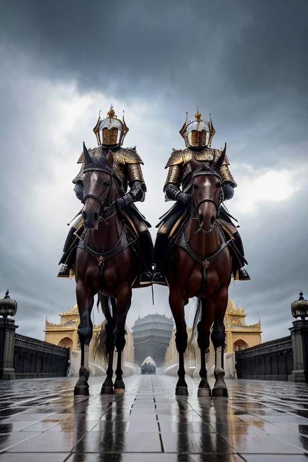

# Does the Dragon Princess Really Hate Me?

*(the title's grammar is intentional)*

**This repository is a novel-writing workflow** — an agent-driven pipeline of 24 story-skills — together with the novel it has produced so far. The story is written act by act in **Hinglish** (Hindi in Latin script; narration and dialogue both in the story's voice).

## How this workflow works

This repo is the **workflow** that writes the novel, plus everything it has produced. The rules live in three tracked documents:

- **[`agent.md`](agent.md)** — the master router. It lists all **24 story-skills** and exactly when each one fires, along with the project's hard rules (language, improvise-don't-copy, pronouns, reader glosses).
- **[`reply-pattern.md`](reply-pattern.md)** — the turn loop the agent runs every single turn.
- **[`style-sheet.md`](style-sheet.md)** — the house style, kept the way a copyeditor keeps it.

### The turn loop

Every turn runs in exactly this order:

1. **Title block** — story title, `Chapter N — Act M: <subtitle>`, then the location.
2. **Novel-style Hinglish narration** — the consequences of the previous reply are woven in; the world and every NPC act on their own agendas; the agent never speaks or acts for the protagonist.
3. **Dialogue** — `Name: "line"`, in-character voices only.
4. **Rivona's Feelings Tracker** — her meters (Hate / Affection / Confusion / Anger / Jealousy), moved only by what the player actually does, never granted freely.
5. **Recap** — a short "where we stand" summary.
6. **"Tumhari baari"** — one direct question, then **STOP**. The human's reply decides what happens next: the story is *discovered*, never pre-planned.

### The skill pipeline

The router in `agent.md` dispatches to one of 24 skills across the whole life of a book:

| Stage | Skills |
|-------|--------|
| **Plan** | premise-workshop → story-init → worldbuilding → character-management → voice-style → theme-craft → genre-craft → plot-structure |
| **Draft** | scene-craft → chapter-writing → (discovery-drafting · verse-craft · interactive-fiction) → line-editing |
| **Revise** | revision-continuity → story-maintenance → series-continuity → reader-panel → feedback-triage → editorial-review |
| **Release** | submission → publishing → adaptation |

### Where the output goes

Each completed act is saved as one file in [`sessions/`](sessions/) — the published scenario only, never raw prompts or planning ([format rules](sessions/FORMAT.md)). The act list below is the result so far.

## The hook

Love is a poor human farmer whose harvest drowned in the rain. With nothing left, he walks fifteen days to the imperial capital to ask the throne for help — and arrives in the middle of the most important royal engagement of a generation.

Then the Ancient Marriage Registry activates on its own. It recognizes a valid marriage bond between Love and **Princess Rivona Vaeltharis**, Crown Princess of the Draconic Empire — a bride who has never met him and wants nothing to do with him.

The Registry is older than the empire itself, and by the Three Laws its ruling can be challenged in exactly one place: the High Court. So Love — with no title, no family name, and no wealth — is legally the husband of a woman who despises him, in a court where dragon blood decides everything.

This is the story of whether contempt, faced every single day, can turn into something else.

## The world

- **723 years** have passed since the Dragon Wars ended. The world has grown peaceful — humans and elves trade, demons attend international conferences, dragon knights escort merchant caravans along mountain roads — but peace is not the same thing as equality.
- The **Legendary Hero** who ended the Dragon Wars carved the **Three Laws** into a monument in every capital: *Tradition, Equal Citizenship, Equal Justice*. Nobles sometimes evade them, and old prejudices remain, but the Laws still give even the weakest person a place to stand and demand justice.
- The **Draconic Empire of Vyrathis** (capital: **Aurelthys**) is the heart of the story. Here, dragon blood still decides social standing: ancient noble houses control the military, the treasury, and the imperial court. A dragon's order can move armies; a commoner's voice can struggle to reach the palace gate.
- The world is shared by **dragons, humans, elves, demons, beastfolk, dwarves, merfolk, and monster tribes**, living under the uneasy peace of the Three Laws — and alongside the **Kingdom of Aurelion**, the **Sylvan Realms**, the **Demon Dominion of Noxharrow**, the **Longhua Dominion**, and the **Bharatvarsha Confederacy**.
- **Magic and magitech**: leyline power is stored in **ley-cells** — compact magical units that drive magitech such as skyships, engines, and city power. Magic can also be accumulated, released, or turned into a weapon, and every use has a cost.
- The **Ancient Marriage Registry** sits at the center of the story: a magical covenant older than the Three Laws, which recognizes binding marriage bonds and answers to no authority but the High Court.

## Read the story

Each act below is one complete chapter-segment, published in [`sessions/`](sessions/) in full novel-style prose.

### Chapter 1 — A marriage that should never have happened

| Act | Title |
|-----|-------|
| 1 | Woh Shaadi Jo Kabhi Nahi Honi Chahiye Thi |
| 2 | Ek Gareeb Kisaan Aur Dragon Princess Ki Shaadi |
| 3 | The Broken Bride |
| 4 | The Farmer Who Refused To Bow To Destiny |
| 5 | The Life He Never Asked For |
| 6 | The Man Who Never Arrived |
| 7 | Broken Bride, Three Laws, Kyle, Envelope |
| 8 | Raat Se Pehle Ka Sannata |
| 9 | Faisle Ki Subah, Unbreakable Bond |
| 10 | Ek Aisa Bandhan Jiska Anjaam Maut Hai |
| 11 | Teen Laws, Ek Dhaaga Aur Ek Behosh Kisaan |
| 12 | Behoshi Ke Peechhe Ka Raaz |
| 13 | Woh Raaz Jo Registry Ne Chhupa Rakha Tha |
| 14 | Hosh Toh Aa Gaya, Musibat Abhi Baaki Hai |
| 15 | Ghar Wapas Jaane Ka Sawaal |
| 16 | Ek Khet, Ek Udaan-Yaan, Aur Ek Devta |
| 17 | Ghar Ki Raah Aur Jungle Ka Pukaar |

### Chapter 2 — Into the forest

| Act | Title |
|-----|-------|
| 1 | Jungle Ka Raasta Aur Ley-Cell Ka Raaz |
| 2 | Maera Ka Gussa Aur Ghayal Kyle |
| 3 | Jungle Ke Upar, Subah Se Pehle |
| 4 | The Two-Hour Nightmare |
| 5 | The Maid With The Kitchen Set |
| 6 | Skyship Se Chhalang |
| 7 | Purple Ash |

## Art

Anime-style character portraits and realistic scene art live in [`images/`](images/).

## License

All rights reserved. See [`LICENSE`](LICENSE).
